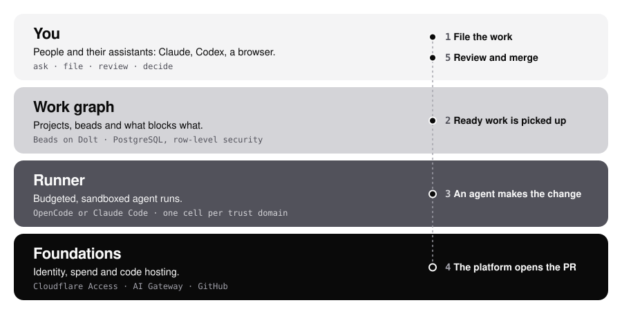
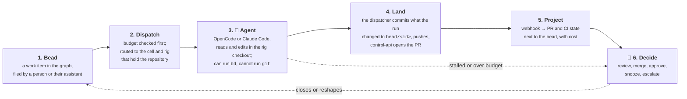
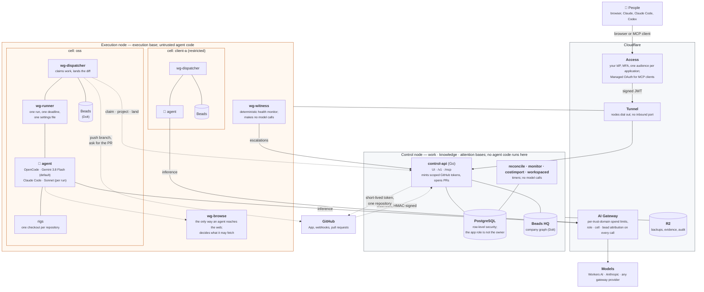

# Architecture

How OpenBases is put together. For what it is and why, start with the [README](README.md) and
[Why we built it](docs/why.md); to run it, [Getting started](docs/getting-started.md).

<p align="center">
  
</p>

## The five bases

Five bases — work, knowledge, attention, execution, improvement — give every project, decision and
agent a shared, governed home. Built to run together; designed to be adopted one at a time.

Each base solves one part of running a company with agents in the loop. They share one control plane,
one identity model and one permission model, and none of them approves its own work.

| Base | What it answers | Where it lives here |
|---|---|---|
| **Work** — *Workgraph* | What needs to happen, and what is blocking it. Projects, portfolios, beads, dependencies, approvals, and the evidence behind every close. One graph, not a dozen boards. | [Beads](https://github.com/gastownhall/beads)/Dolt graphs · `internal/work` · `internal/approvals` · the registry (`projects`, `portfolios`, `role_grants`) · `wg` CLI · `/mcp` tools |
| **Knowledge** | What the company knows, and where it came from. A meeting or document becomes a typed *candidate*; a named human accepts it; only then is it a record, carrying source, reviewer and classification. | `internal/ingest` · `internal/knowledge` · `internal/publish` · `workspaced` (Google Meet and Drive) · the classification policies |
| **Attention** | What needs a human right now. A ranked, permission-aware feed of decisions, risks and stalls — assembled for one person, not broadcast to everyone. | `internal/attention` · the inbox · `wg-witness` and `wg-monitor` escalations · the chief-of-staff "ask" |
| **Execution** | Who — or what — does the work, safely. Agents run in isolated cells scoped to the repositories, tools and budget they may touch; every call is attributed; the platform, not the agent, lands the result as a pull request. | cells · `wg-dispatcher` · `wg-runner` · OpenCode / Claude Code · `wg-budget` · cost import · `wg-browse` · the GitHub App |
| **Improvement** | How the system gets better, on evidence: a proposed change to a prompt, policy or process arrives with the evidence behind it and a test that proves it worked. | `internal/improvement`, `internal/evaluation` — **designed, not built**; both packages are a `doc.go` and nothing else ([ADR-0014](docs/adr/0014-governed-self-improvement.md)) |

The word *base* is literal: each is a schema, a set of policies, and the code that enforces them,
sitting on the same PostgreSQL with row-level security. Today they deploy as one system. Making each
separately adoptable — the knowledge base without the work base, the execution base's isolation model
around agents you already run — is the direction, and the package boundaries above are where the seams
are.

## What happens to a piece of work



Steps 1 and 6 are the work base; 2–4 the execution base; 5 the work base again; the dashed edge into
6 is the attention base. Nothing on the path approves itself. An agent can propose work, edit files and
comment on its bead. It cannot push, merge, widen a classification, or change its own budget. The pull
request it produces says so in its body: *"Opened by a Workgraph agent run. Nobody has reviewed this."*

## How it fits together

Two machines, neither with an inbound port. Everything a person touches goes through Cloudflare Access
first; everything an agent touches is scoped to one cell.



The dashed edges are the ones that matter for security:

- **A cell never holds a git credential.** The dispatcher asks `control-api` for a token scoped to one
  repository, over an Access application bound to that single path, and gets one that expires within
  the hour. The GitHub App private key can mint tokens for *every* installed repository, so it stays on
  the control node where no agent code runs. The agent itself cannot run `git` at all.
- **GitHub webhooks bypass Access**, because GitHub cannot complete an Access challenge. An HMAC
  signature, verified before parsing, is the only thing standing between that endpoint and anyone who
  learns its URL.
- **Cells cannot see each other.** Separate Linux users, `0700` homes, a `0711` cells root so one
  cannot even enumerate the others' names, cgroup limits, and `hidepid` so one cannot read another's
  process arguments.
- **An agent reaches the web through one command** that decides what it may fetch. `wg-browse` resolves
  the host, refuses link-local and private addresses, and pins the resolution so a name cannot change
  between the check and the fetch. The node's own cloud-metadata endpoint answers `200` to `curl`, and
  is the first thing it refuses.
- **What a person sees through MCP is what they see in the browser.** Same identity, same row-level
  security, same role. No pasted tokens.

Known limits are listed, not hidden: [`docs/go-live/threat-model.md`](docs/go-live/threat-model.md)
records the accepted risks and the conditions that would change them.

## How the registry is shaped

An organisation has portfolios (client · product · oss · internal); a portfolio has projects; a project
has repositories, a primary **and** a backup owner, and runs in one execution cell. A restricted project
must have its own cell — the schema refuses otherwise. Work lives in Beads, one graph per cell and one
company graph on the control node, and a bead is attributed to a project by its `wg-project-<slug>`
label. The older `project:<slug>` spelling is still honoured on read, and both are collected into one
set so a bead labelled both ways is caught rather than counted twice
([0082](db/migrations/0082_project_label_convention.sql)).

There are no subprojects, deliberately: nesting would make membership transitive and change the reach
of every policy that delegates to `can_read_project()`. Nine roles, scoped per project or
organisation-wide, decide what a person may do to the rows they can already see
([ADR-0026](docs/adr/0026-role-permission-matrix.md)). The organisation admin cannot approve; the
executive cannot dispatch. Separation of duties beats convenience.

## Harnesses and models

Model choice is a property of the **work**, not of whichever agent picks it up
([ADR-0018](docs/adr/0018-tiered-model-routing.md),
[ADR-0024](docs/adr/0024-multi-provider-agent-runtimes.md)). Different work wants different models —
frontier models from US labs, increasingly capable open models from China, small open models for
mechanical steps — and no team should wait on one vendor's roadmap. The harness and the model are
deployed configuration; the tool allowlist is code somebody reviews.

| Role | Harness | Model | Since |
|---|---|---|---|
| `polecat`, `crew`: the agents that do the work | OpenCode | `google-ai-studio/gemini-3.8-flash` | 14 Sep 2026 |
| any run, on request | Claude Code | `anthropic/claude-sonnet-5` | `-runtime claude -model anthropic/claude-sonnet-5` |

How the default got here. On the bake-off screens (context, tool use, a real fix scored on the edit)
GLM 5.3 Flash and Sonnet both passed, and GLM cost **$0.0037** against Sonnet's **$0.2732** for the same
passing result, every call tagged by role, cell and bead in `usage_records`. GLM became the default on
7 September. On real beads it looped and landed nothing: one bead cost $3.26, twice, for no change. On
14 September the default moved to Gemini 3.8 Flash, through the same AI Gateway and the same bill.
The bake-off measured whether a model can do the work at all; only real work measured whether it
finishes. Measurements and their caveats: [`docs/evaluations/`](docs/evaluations/).

Gemini runs on its native API through a loopback proxy on the node, because the OpenAI-compatible
route drops the signature Gemini attaches to each tool call and the second call fails. The gateway
token lives in that proxy, never in the agent's configuration.

Planning is no longer an agent's job. Breaking a goal into work is judgement, and it is best done by the
person who knows the goal, in whatever tool they already think in (Claude, Codex, a document).
OpenBases records the plan as beads and runs it; filing costs nothing and starts no agent.

Two rules that survived every measurement. **Context is a hard filter before quality**: OpenCode's system
prompt is ~19,900 tokens, so a model with a 24k window cannot be a worker whatever the leaderboard says.
And **no model choice beats not making the call**: the health monitor, the dispatcher and the reconciler
make none, which is why one day of idle patrol agents costing $13 became zero.

Every run is budgeted before it starts. `wg-budget` resolves the bead's own ceiling, else its project's,
else its cell's, and refuses the dispatch — a refusal the person sees in the interface, not in a journal
afterwards.

## Clients and MCP

Most people never open the web interface. OpenBases serves a remote MCP server at `/mcp`, so its tools
appear inside the clients people already use — Claude (desktop, web, mobile), Claude Code, Codex, and
anything else that speaks MCP over HTTP.

```bash
claude mcp add --transport http openbases https://<your-host>/mcp
```

Your browser opens the normal identity-provider login and Cloudflare Access issues the token. OpenBases
implements no OAuth of its own, and what you see through a connector is exactly what you see in the
browser ([ADR-0028](docs/adr/0028-remote-mcp-via-access-managed-oauth.md)). On a laptop with a shell,
`wg mcp` serves the same tools over stdio. Confirmed clients and how to revoke access:
[`docs/runbooks/connect-a-client.md`](docs/runbooks/connect-a-client.md).

Nine tools, the same set over both transports, so nothing is available in one client and missing in
another: the inbox, the chief-of-staff ask, work and one bead in detail, projects, **creating a project
and attaching repositories**, filing work from a brief, and dispatching. Detaching a repository and
setting a repository's check command are deliberately not tools — the first withdraws the route work
travels on, the second is executed on the execution node from a repository an agent can edit.

New here? [`docs/getting-started.md`](docs/getting-started.md) covers all three ways in: on your laptop,
deploying your own, and running your first work through the MCP.

## Layout

```
apps/web/          React + TypeScript interface, embedded into control-api
cmd/               control-api · dispatcher · runner · witness · monitor · reconcile · costimport · workspaced · wg
internal/          work · knowledge · attention · improvement · approvals · authn · authz · runner · githubapp · ingest · publish …
db/migrations/     forward-only SQL; row-level security on every table holding source-derived content
infra/             OpenTofu (Hetzner, Cloudflare), Ansible (nodes, cells, harnesses), Google Workspace events
formulas/          workflow formulas
policies/          policy bundles evaluated by the approval engine
skills/            the skill for agents that use OpenBases as a tool
docs/getting-started.md  run your first work through the MCP — start here for "how"
docs/adr/          architecture decision records — start here for "why"
docs/evaluations/  measured model and harness results, dated
docs/runbooks/     operator runbooks
test/              contract (real bd), integration (real PostgreSQL), acceptance (against staging)
versions.lock      the pinned, checksummed toolchain: bd, dolt, gt, opencode, claude, node, chrome-headless-shell
```

