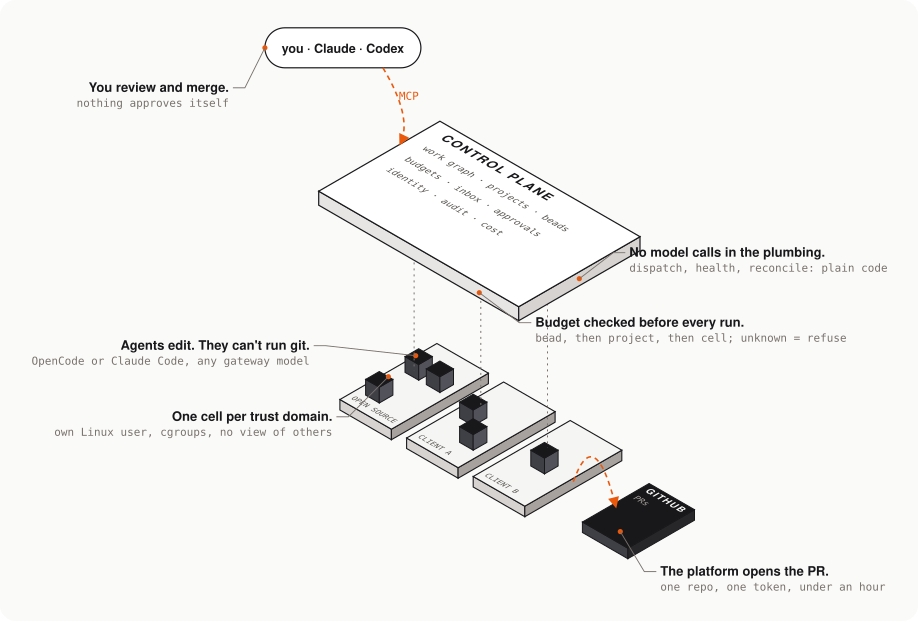
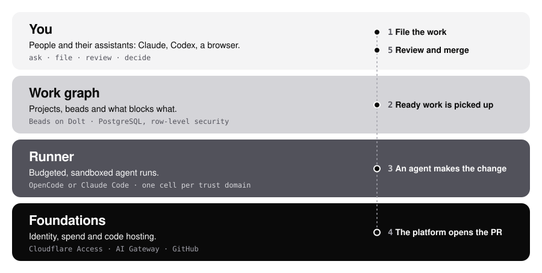

<p align="center">
  
</p>

<p align="center">
  <b>A work graph for coding agents.</b><br>
  Self-hosted and shared by people and agents · agents run headless in sandboxes · they can't push · every run is budgeted
</p>

<p align="center">
  <a href="docs/getting-started.md">Getting started</a> ·
  <a href="#what-works-today">What works today</a> ·
  <a href="docs/why.md">Why we built it</a> ·
  <a href="ARCHITECTURE.md">Architecture</a> ·
  <a href="CONTRIBUTING.md">Contributing</a>
</p>

---

> **Status: alpha.** We run this for real work. Four of the five bases are full operational today;
> the fifth (improvement/learning) is designed and not built. Open Source under Apache-2.0.

Once you have more than a few agents working, the hard part stops being the agent. It's
coordination: what work exists, what blocks what, who picked it up, and what's waiting on a human.
You need a graph of work for that, so agents can hand off and nobody does the same task twice.

OpenBases is that layer, and it runs real work across [Datopian](https://www.datopian.com), the
agile data consultancy that builds it. It is for teams already running Claude Code,
Codex or OpenCode who need to track, limit and review what those agents do.

<p align="center">
  
</p>

## Why it's built this way

- **The work graph is the control plane.** People and agents read and write one graph of work
  ([Beads](https://github.com/gastownhall/beads) on Dolt), from a browser or through MCP.
- **Headless on a server, not on a laptop.** [Gas Town](https://github.com/gastownhall/gastown)
  needs somebody at a terminal. We replaced its orchestration with a plain runner, and every run
  became attributable to a piece of work.
- **Boring plumbing; models only for judgement.** Dispatch, health checks and reconciliation are
  plain code, so idle patrol cost went from $13 a day to zero.
- **Model choice is configuration, and measured.** The default worker moved from GLM 5.3 Flash to
  Gemini 3.8 Flash when real work showed GLM looping. Any bead can ask for Claude.
- **Every run is budgeted, and unknown means no.** The bead's ceiling, else its project's, else its
  cell's, is checked before anything is spent.
- **Agents are untrusted.** Each runs in a sandboxed cell with no git credential. The platform opens
  the pull request and a person merges. Nothing approves itself.
- **Meet people where they already work.** Claude, Claude Code and Codex connect over MCP, and what
  you see there is exactly what you see in the browser.

The evidence for each, and the mistakes we learnt from: **[Why we built it](docs/why.md)**. How the
pieces fit: **[Architecture](ARCHITECTURE.md)**.

### New here?

| If you want to… | Start with |
|---|---|
| Understand what it is | [Why it's built this way](#why-its-built-this-way), then [`ARCHITECTURE.md`](ARCHITECTURE.md) |
| Try it, or deploy it | [`docs/getting-started.md`](docs/getting-started.md): on your laptop, on your own servers, or on a deployment that exists |
| Judge whether to trust it | [How it fits together](ARCHITECTURE.md#how-it-fits-together) and the [threat model](docs/go-live/threat-model.md) |
| Know why it is built this way | [`docs/why.md`](docs/why.md), one page; then the ADRs in [`docs/adr/`](docs/adr/) |

## Get started

- **On your laptop**, in about ten minutes: the interface, the API and the MCP server against an
  empty organisation. No agents. [Getting started, part 1](docs/getting-started.md#1-run-it-on-your-laptop).
- **On your own servers**: two Hetzner nodes behind Cloudflare, a GitHub App, about a day.
  [Part 2](docs/getting-started.md#2-deploy-your-own).
- **On a deployment that exists**: connect Claude, Claude Code or Codex and run your first piece of
  work. [Part 3](docs/getting-started.md#3-run-your-first-work).

```bash
claude mcp add --transport http openbases https://<your-host>/mcp
```

## How it compares

**What it is like to use.** You talk to Claude or Codex as you already do; it files beads into the
shared graph through MCP. You dispatch one, or let the dispatcher pick up what is ready. A pull
request arrives on GitHub with its cost next to it, and you review and merge.

**What else is out there.** Three groups. *Session managers* (Conductor, Vibe Kanban, Kanbots,
Emdash and a dozen more) run several Claude Code or Codex sessions in parallel on one laptop, often
as a kanban; a good job, and a different one from holding a team's work. *Agent sandboxes* (NVIDIA
OpenShell, Runtime, OneCLI) answer "how do we let a team run agents safely" with a confined runtime
and credentials kept out of the agent; they do not hold the work. *Orchestrators* break work up and
hand it off: Gas Town, Paperclip, Claude's Agent Teams, Optio. OpenBases is an orchestrator with the
sandbox group's stance, built around one graph of work for the whole company.

**Gas Town.** We started on it and kept Beads, its work graph. Gas Town is built to be driven by a
person at a terminal, where tmux sessions exist because somebody made them, and its patrol roles are
model sessions. Our nodes have nobody at a terminal, so we replaced the orchestration with a plain
runner and a monitor that makes no model calls ([ADR-0023](docs/adr/0023-direct-agent-runner.md),
[ADR-0019](docs/adr/0019-deterministic-witness.md)).

**Paperclip.** Closest in ambition: self-hosted, issues with dependencies, budgets with hard stops,
approval gates, optional Bubblewrap confinement. We did not adopt it because its isolation unit is
the company and ours has to be the client engagement inside one; it deliberately does not open pull
requests; and its approvals are not bound to a digest of what was approved. Its review policies and
budget scoping became design inputs ([ADR-0017](docs/adr/0017-not-adopting-paperclip.md)).

| | Where it runs | Unit of work | Isolation | Who lands the result |
|---|---|---|---|---|
| Session managers | your laptop | a session or card | one person's machine | you |
| Agent sandboxes | a confined runtime | a run | the product's point | your own tooling |
| Gas Town | a machine with a terminal | beads in convoys | a worktree per polecat | its merge queue |
| Paperclip | your server | issues with heartbeats | per company; Bubblewrap optional | its approvals; no PRs |
| OpenBases | your server, headless | a bead in one company graph | a Linux user per cell, no git credential, a budget | the platform opens a PR, a human merges |

## Architecture

<p align="center">
  
</p>

Four layers. You and your assistants file and review work. The work graph holds it until it is
ready. The runner checks the budget and gives it to an agent in a sandboxed cell. The foundations
(Cloudflare Access, AI Gateway, GitHub) handle identity, spend and the pull request. The full
picture, with the security boundaries: **[ARCHITECTURE.md](ARCHITECTURE.md)**.

## What works today

*Updated 5 November 2026. If this table and the code disagree, the code is right and this is a bug.*

| Base | Capability | State |
|---|---|---|
| Work | Login via Cloudflare Access; projects, work, inbox, ask in the browser | works |
| Work | Remote MCP (`/mcp`) with Access Managed OAuth; `wg` CLI; `wg mcp` stdio | works — confirmed clients in the runbook |
| Work | File a plan as beads under a project, from MCP, the CLI or the API (free, no agent); create a project and attach repositories from MCP | works; agent-run planning was removed on 10 September |
| Work | Bead detail — outcome, the agent's own words, harness and model, cost, pull requests | works in the API, MCP and the bead page; a run in flight reports its harness and model, and says when its cost has not been imported yet |
| Work | Role-permission matrix enforcement | seeded; enforcement flag off until every role has a real user |
| Knowledge | Meeting transcript → typed candidates → human review → bead or knowledge PR | works via API and MCP; **no review page in the interface** — review is an API call today |
| Attention | Ranked inbox of witness and monitor escalations; four fixed chief-of-staff questions | works; approvals have no producer yet, free-text ask is by design absent |
| Execution | Dispatch → agent edits in the rig → branch → pull request → state next to the bead | works; ready beads run in parallel, up to three per cell by default |
| Execution | Acceptance check: a judge model scores the delivered change against the bead's acceptance criteria ([ADR-0029](docs/adr/0029-jev-acceptance-gate.md)) | shadow mode: the verdict is recorded on the bead and blocks nothing |
| Execution | Per-bead budget refusal; cost per bead from gateway import | works (cost arrives on an hourly import) |
| Execution | Isolated cells, one rig per repository, deterministic witness, `wg-browse` | works |
| Execution | A repository's own build or test command run against the change, with one retry | works where the cell can run it; **not enabled for any repository yet**, and PortalJS does not fit — `npm ci` alone needs 7m5s against a 7.5-minute budget |
| Improvement | Evidence-backed change proposals with tests | designed, not built |
| — | Local `make dev` stack | not assembled; run `control-api` directly |
| — | Deploy on merge to `main` | works, to staging |
| — | Production deployment | not yet; staging only |

## How this came to be

OpenBases started as a way to run [Gas Town](https://github.com/gastownhall/gastown) and
[Beads](https://github.com/gastownhall/beads) for a whole company instead of one laptop, under the name
Workgraph — which is now the name of the work base. Beads stayed: the work graph, its Dolt history and its
CLI are what agents and people share. Gas Town's orchestration did not survive contact with a headless
node, and on 26 August 2026 we replaced it with a direct runner — a working directory, a settings file,
one command — and a deterministic health monitor; the model bill roughly halved, and every agent run
became attributable ([ADR-0023](docs/adr/0023-direct-agent-runner.md)). The vocabulary (cells, rigs,
beads) is what is left of the town, and the thirty-one ADRs in [`docs/adr/`](docs/adr/) record every
turn on the way, including the ones that were wrong.

> **On the name.** The system is OpenBases; the work base is still called Workgraph, which is what the
> whole thing was called until September 2026. The code has not been renamed and mostly should not be:
> binaries are `wg-*`, the database and its application role are `workgraph` and `workgraph_app`, bead
> labels are `wg-project-<slug>`, and the MCP tools are `workgraph_*` — all of which belong to the work
> base and are correct there. Where you see `wg` or `workgraph` in this repository, it is the work base or its
> heritage, not a rename left half-done.

## Contributing

Read [`CONTRIBUTING.md`](CONTRIBUTING.md) and [`AGENTS.md`](AGENTS.md) before your first change. The
short version: every change is attached to a bead; one bead, one branch `bead/<id>-<slug>`, one pull
request; close a bead with evidence, not an opinion; never commit a secret; never publish unreviewed
model extraction; never widen a classification; nothing approves itself. Much of this repository was
written by agents running inside it, and every rule above exists because one of them found the gap.

What we care about in review, in this order: does it actually work and how do you know; is the reasoning
in the repository; is it honest about what it does not do.

Security issues: [`SECURITY.md`](SECURITY.md) — use GitHub's private vulnerability reporting. There is
deliberately no `security@` alias quoted, because an address nobody monitors looks like a channel and
silently is not.

Licence: [Apache-2.0](LICENSE), © 2026 Datopian Inc. The licence text is the canonical one from
apache.org with only the appendix's copyright placeholder filled in.
