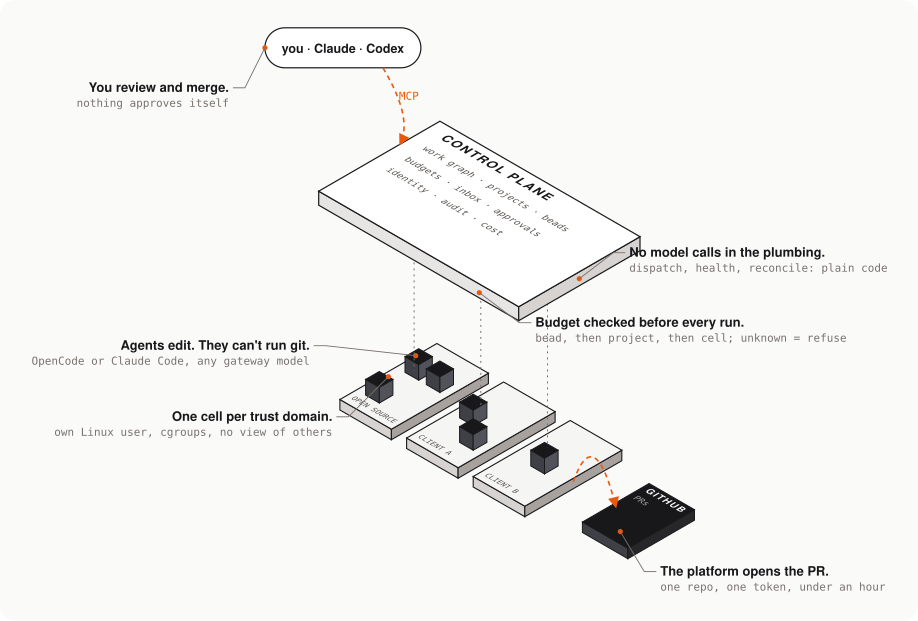

# Why OpenBases

OpenBases is a work graph for coding agents: self-hosted, shared by a team's people and its agents, with the agents running headless on a server in sandboxes. They cannot push, and every run is budgeted.

Once you have more than a few agents working, the hard part stops being the agent. **It is coordination: what work exists, what blocks what, who picked it up, and what is waiting on a human**.

Without a shared graph of work, agents duplicate tasks and nobody can answer "what is happening across the company". OpenBases is that layer. [Datopian](https://datopian.com/), an agile data consultancy, built it to run its own work.

This page details the bets behind it; the decision records in [adr/](adr/) hold the detail, including the mistakes that we made and learned from.

  

## The bets

**The work graph is the control plane.** Work items live in [Beads](https://github.com/gastownhall/beads), backed by Dolt, and agents and people read and write the same graph. We rejected both obvious alternatives: one all-seeing orchestrator makes the orchestrator the security boundary, and one graph per person means no portfolio view and duplicated work, the problem we were trying to fix. Beads is used unforked and the control plane holds only a rebuildable projection, because two trackers drift and agents then act on stale readiness. [ADR-0001](adr/0001-shared-company-graph.md), [ADR-0003](adr/0003-beads-as-canonical-work-state.md).

**Run headless on a server, not on a laptop.** We started on [Gas Town](https://github.com/gastownhall/gastown). It starts agents by respawning a tmux pane that somebody at a terminal already created, so on a node with nobody at a terminal every agent failed, and upgrading to the latest release failed identically. On 26 August 2026 we replaced its orchestration with a plain runner (a working directory, a settings file, one command). The model bill roughly halved and every run became attributable to a work item. [ADR-0023](adr/0023-direct-agent-runner.md).

**Boring, deterministic plumbing; a model only where there is judgement.** Gas Town's witness was a Claude Code session paid to read booleans every five minutes. One day of testing cost $23, of which $13 was patrol roles doing 1,616 requests of no work. We replaced the witness with a program; today the health monitor, dispatcher and reconciler make no model calls at all, and idle cost is zero. The rule generalises: anything decidable by comparison is decided by comparison, and inference is reserved for ambiguity. [ADR-0018](adr/0018-tiered-model-routing.md), [ADR-0019](adr/0019-deterministic-witness.md).

**Model choice is per-role configuration, measured, and changed when the evidence says so.** No team should wait on one vendor's roadmap, so the harness and model are deployed configuration, not code (OpenCode or Claude Code; any provider the Cloudflare AI Gateway reaches, on one bill). The default worker moved to GLM 5.3 Flash in September 2026 after a bake-off on context, tool use and a real fix scored on the edit: the same passing fix cost $0.0037 against $0.2732 for Sonnet 5. The caveat we wrote then was that the screens were an off-by-one and a file edit, not evidence it matched Sonnet on hard work. Real beads proved the caveat: GLM looped and landed nothing (one bead cost $3.26 twice), so on 14 September the default became Gemini 3.8 Flash through the same gateway, with attribution unchanged. Any run can still ask for Claude Code and Sonnet. [ADR-0024](adr/0024-multi-provider-agent-runtimes.md), [evaluations/](evaluations/wg-hvb-worker-models.md).

**Every run is budgeted before it starts, and an unknown is a refusal.** The bead's ceiling, else its project's, else its cell's, is checked at dispatch. Stale spend data, nothing imported, or an unreachable control plane all refuse, because a budget that fails open stops existing exactly when the platform is unwell. Every gateway call is tagged with role, cell and bead, so cost per piece of work is a query. [ADR-0022](adr/0022-per-bead-budgets.md), [ADR-0021](adr/0021-durable-cost-records.md).

**Agents are untrusted.** Each runs in an execution cell drawn by trust domain: a separate Linux user, its own home, cgroup limits, no view of other cells. A cell never holds a git credential and the agent cannot run `git`. The dispatcher lands the diff with a token scoped to one repository that expires within the hour; the platform opens the pull request and a human merges. Nothing approves itself: an agent can propose work, edit files and comment on its bead, but cannot push, merge, widen a classification or change its own budget. Closing a bead is an assertion, not proof, so an acceptance check now judges the delivered change against the bead's acceptance criteria, in shadow mode until calibrated ([ADR-0029](adr/0029-jev-acceptance-gate.md)). We did not adopt Paperclip mainly because its isolation unit is the company, and ours has to be the client engagement inside one company. [ADR-0002](adr/0002-execution-cells-by-trust-boundary.md), [ADR-0017](adr/0017-not-adopting-paperclip.md), [threat model](go-live/threat-model.md).

**Meet people in the clients they already use.** The team lives in Claude Code, Claude or Codex, so OpenBases serves a remote MCP server with the same nine tools over HTTP and stdio. Login is the normal Cloudflare Access flow; we implement no OAuth of our own, and what you see through a connector is exactly what you see in the browser. [ADR-0025](adr/0025-api-first-external-clients.md), [ADR-0028](adr/0028-remote-mcp-via-access-managed-oauth.md).

**Small footprint, no Kubernetes.** Two Hetzner nodes behind Cloudflare Access and Tunnels, Docker Compose and systemd, provisioned with OpenTofu and Ansible. The restore path fits in an operator's head. [ADR-0010](adr/0010-no-kubernetes-in-v1.md).

**The reasoning lives in the repository.** Apache-2.0, with a decision record written before the code that depends on it. Much of the repository was written by agents running inside it, and every rule in [CONTRIBUTING.md](../CONTRIBUTING.md) exists because one found the gap.

## What it is not, yet

This is alpha. One company runs it, on staging, for real work; there is no production deployment. Merging to `main` deploys staging automatically, and ready beads run in parallel up to a per-cell ceiling (three by default). Four of the five bases (work, knowledge, attention, execution) run; the fifth, improvement, is designed and not built. `make dev` is not assembled, the knowledge review step has no page in the interface, and installing outside our setup is still rough. What is missing is listed by name in [what works today](../README.md#what-works-today) and [deployable by others](install/deployable-by-others.md).

## Mistakes we learnt from

Each of these is recorded in full in the linked document. The rule at the end of each entry is the part that survived.

**We ran Gas Town on a headless node.** Gas Town starts an agent with `tmux respawn-pane`, which revives a pane that somebody at a terminal already created; on a server with nobody at a terminal every agent failed, `gt up` printed a tick for the Mayor while `pgrep claude` returned zero, and the town was silent from 16 August 2026 until the gateway logs went quiet the next day. The latest release failed identically, so on 26 August we replaced the orchestration with a plain runner. Rule: a tick in a tool's output is not evidence that a process is running; check the process. [ADR-0023](adr/0023-direct-agent-runner.md).

**We paid a frontier model to read booleans.** The stock witness was a Claude Code session re-primed every five minutes to run `gt polecat list --json` and interpret the result. One day of testing in August cost $23, of which $13 was patrol roles making 1,616 requests that did no work, and moving them to Haiku cut the rate but left the request count. We disabled the patrol and wrote a program; every decision it takes records a `used_model` column, and the count of model calls is zero. Rule: remove unnecessary calls before choosing a cheaper model. [ADR-0018](adr/0018-tiered-model-routing.md), [ADR-0019](adr/0019-deterministic-witness.md).

**We promoted a model on a bake-off of two small tasks.** GLM 5.3 Flash passed the context, tool-use and off-by-one screens at $0.0037 against $0.2732 for Sonnet 5 and became the default worker, with a written caveat that this was not evidence it matched Sonnet on hard work. On real beads it looped and landed nothing (one bead cost $3.26 twice), and on 14 September 2026 the default moved to Gemini 3.8 Flash. The same evaluation also found three of seven context-window figures wrong because they had been written from memory, so those numbers are now read from the account's model API by a script. Rule: a bake-off shortlists; only real beads with cost attached pick a default, and a number nobody checked reads exactly like a measurement. [evaluations/wg-hvb-worker-models.md](evaluations/wg-hvb-worker-models.md), [PR #325](https://github.com/datopian/openbases/pull/325).

**We trusted `failed=0`.** Twice the Ansible recap said success while the nodes said otherwise. On 9 September 2026 an 11-minute run with `failed=0` installed nothing, because the build directory was empty and every install task skips on an empty path; the next run changed 14 files on the control node that were stale too. Separately, `--start-at-task "Install the migration tool"` applied migrations and left the API running code two commits old, because the binary install sits before that task. A play now refuses a deploy whose build directory is empty, migrations-only deploys use `--tags migrate`, and `check_infra.py` fails if a binary install is missing the tag. Rule: the recap is not evidence; `changed=` and `stat` on the node are. [runbooks/deploying.md](runbooks/deploying.md), [infra/ansible/README.md](../infra/ansible/README.md).

**We seeded client names from migrations.** Twenty migrations inserted Datopian's organisation, eight staff by work email, their admin grants and thirteen projects, including two client engagements. A fresh install therefore came up as Datopian, and because `cmd/migrate` refuses an edited migration those rows are in the source tree permanently. Records about the real world now enter through an idempotent bootstrap (`wg-init`) or the API, never a migration, and `check_disclosure.py` fails CI and the pre-push hook on a new one. Even so, the deploy playbook ran a plain migrate on an empty database until 5 November 2026; it now passes `-fresh` ([PR #352](https://github.com/datopian/openbases/pull/352)). Rule: a migration is schema and backfill; anything that names a real person, client or repository is data. [AGENTS.md](../AGENTS.md), [install/deployable-by-others.md](install/deployable-by-others.md).

**The `-fresh` manifest was wrong in both directions.** The list of seed migrations that a fresh install skips included two files that only define functions, so a fresh install came up clean and could not register a node, which is to say could not run an agent; and it missed two that seeded ten real addresses into `credential_registry`. The test matched `CREATE FUNCTION` while the files said `CREATE OR REPLACE FUNCTION`, and the empty-table assertion listed what should be empty instead of what may be populated. It was caught because the manifest and the disclosure baseline named different files. Rule: two guards disagreeing is worth more than either agreeing with itself, so their divergence is now itself a CI failure. [install/deployable-by-others.md](install/deployable-by-others.md).

**We reasoned about blast radius instead of checking it.** On 12 August 2026 we set `deny_unmatched_requests` on the shared Cloudflare Zero Trust organisation, arguing it could only affect hostnames with an Access application, of which there were none. It returned 403s on live production zones belonging to Datopian's other sites, and a person noticed before any monitor did. It was reverted through OpenTofu, pinned to `false` in `check_infra.py` so it cannot drift back, and any unreviewed account-level attribute now fails the build. Rule: a blast-radius argument is not evidence; prefer a per-application control over an account-level one. [incidents/2026-08-12](incidents/2026-08-12-deny-unmatched-requests.md).

## Who it is for

For teams already running Claude Code, Codex or OpenCode who need to track, limit and review what those agents do, on their own server. One company per deployment; multi-tenancy is not supported.

## Next

- [Getting started](getting-started.md): run it on a laptop, deploy your own, or run your first work.
- [What works today](../README.md#what-works-today): the honest table.
- [ADR index](adr/README.md): every decision, including the wrong ones.
